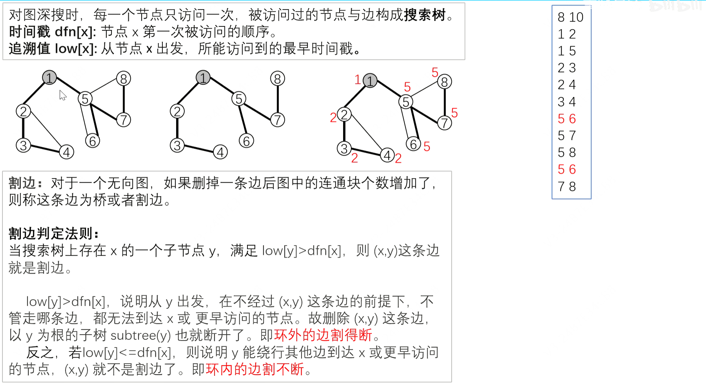

### 题目情境

题目链接：https://www.luogu.com.cn/problem/P1656

**题目描述**

A 国派出将军 uim，对 B 国进行战略性措施，以解救涂炭的生灵。

B 国有 $$n$$ 个城市，这些城市以铁路相连。任意两个城市都可以通过铁路直接或者间接到达。

uim 发现有些铁路被毁坏之后，某两个城市无法互相通过铁路到达。这样的铁路就被称为 key road。

uim 为了尽快使该国的物流系统瘫痪，希望炸毁铁路，以达到存在某两个城市无法互相通过铁路到达的效果。

然而，只有一发炮弹（A 国国会不给钱了）。所以，他能轰炸哪一条铁路呢？

**输入格式**

第一行 $$n,m\ (1 \leq n\leq 150$$，$$1 \leq m \leq 5000)$$，分别表示有 $$n$$ 个城市，总共 $$m$$ 条铁路。

以下 $$m$$ 行，每行两个整数 $$a, b$$，表示城市 $$a$$ 和城市 $$b$$ 之间有铁路直接连接。

**输出格式**

输出有若干行。

每行包含两个数字 $$a,b$$，其中 $$a<b$$，表示 $$\lang a,b\rang$$ 是 key road。

请注意：输出时，所有的数对 $$\lang a,b\rang$$ 必须按照 $$a$$ 从小到大排序输出；如果 $$a$$ 相同，则根据 $$b$$ 从小到大排序。

输入 #1

```
6 6
1 2
2 3
2 4
3 5
4 5
5 6
```

输出 #1

```
1 2
5 6
```

### 算法解析：



Tarjan 判割边（桥）：DFS 记录 $dfn$ 和 $low$。对 DFS 树边 $(u,v)$，若 $low[v] > dfn[u]$（$v$ 的子树无法回到 $u$ 或 $u$ 以上），则该边是桥（key road）。用 `vector<int>` 邻接表保存有向边编号，终点保存在 `to` 中；每条无向边的两个方向依次编号为 $2i$ 和 $2i+1$，编号异或 $1$ 就是反向边。DFS 只跳过进入当前节点的那条边的反向边，因此重边仍能更新 $low$，自环也不会被误判为桥。输出时先把每条桥的端点整理为 $a<b$，再按字典序排序。找桥的复杂度为 $O(n+m)$，若有 $k$ 条桥，排序的复杂度为 $O(k\log k)$。

### py代码实现

略，涉及到dfs的都不适合写python。

### C++代码实现

```c++
#include<bits/stdc++.h>
using namespace std;

int n,m,a,b;
vector<vector<int>> e;
vector<int> to; //邻接表保存边编号，to[id] 保存终点
vector<pair<int,int>> bri;
vector<int> dfn,low;
int tim;

void add_edge(int a,int b){
  int id=static_cast<int>(to.size());
  e[a].push_back(id); to.push_back(b);
  e[b].push_back(id+1); to.push_back(a);
}

void tarjan(int x,int in_edge){
  dfn[x]=low[x]=++tim;
  for(int id:e[x]){
    if(in_edge!=-1&&id==(in_edge^1)) continue; //只跳过反向树边
    int y=to[id];
    if(!dfn[y]){ //若y未访问
      tarjan(y,id);
      low[x]=min(low[x],low[y]);
      if(low[y]>dfn[x]) bri.push_back({min(x,y),max(x,y)});
    }
    else
      low[x]=min(low[x],dfn[y]);
  }
}
int main(){
  ios::sync_with_stdio(false); cin.tie(nullptr);
  cin>>n>>m;
  e.assign(n+1,{}); dfn.assign(n+1,0); low.assign(n+1,0);
  to.reserve(2*m);
  for(int i=0;i<m;i++){
    cin>>a>>b;
    add_edge(a,b);
  }
  for(int i=1;i<=n;i++) if(!dfn[i])tarjan(i,-1);
  sort(bri.begin(),bri.end());
  for(auto [x,y]:bri) cout<<x<<" "<<y<<"\n";
}
```
