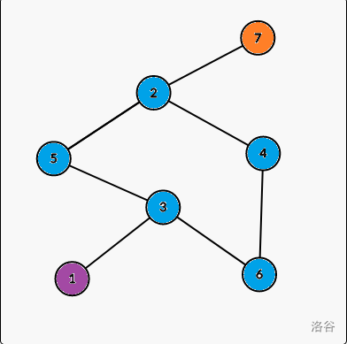
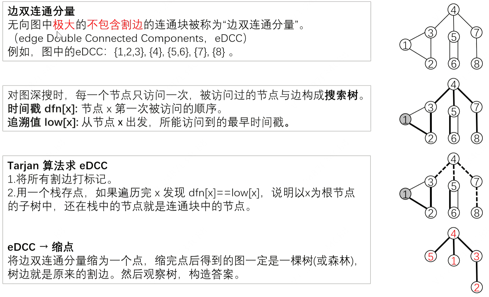

### 题目情境

题目链接：https://www.luogu.com.cn/problem/P8436

**题目描述**

对于一个 $$n$$ 个节点 $$m$$ 条无向边的图，请输出其边双连通分量的个数，并且输出每个边双连通分量。

**输入格式**

第一行，两个整数 $$n$$ 和 $$m$$。

接下来 $$m$$ 行，每行两个整数 $$u, v$$，表示一条无向边。

**不保证图为简单图，图中可能有重边和自环。**

**输出格式**

第一行一个整数 $$x$$ 表示边双连通分量的个数。

接下来的 $$x$$ 行，每行第一个数 $$a$$ 表示该分量结点个数，然后 $$a$$ 个数，描述一个边双连通分量。

你可以以任意顺序输出边双连通分量与边双连通分量内的结点。

输入 #1

```
7 8
1 3
2 4
3 5
2 5
6 4
2 5
6 3
2 7
```

输出 #1

```
3
1 1
5 2 5 3 6 4
1 7
```

**样例1解释：**



相同颜色的点为同一个连通分量。

**数据范围：**
对于 $$100\%$$ 的数据，$$1 \le n \le 5 \times10 ^5$$，$$1 \le m \le 2 \times 10^6$$。

### 算法解析：



边双连通分量（eDCC）：删去图中所有桥之后，每个连通块就是一个 eDCC。下面用 Tarjan 配合顶点栈直接划分分量：访问顶点时入栈，当 $low[x]=dfn[x]$ 时，依次弹出栈顶到 $x$ 的顶点，构成一个 eDCC。用 `vector<int>` 邻接表保存有向边编号，终点保存在 `to` 中；每条无向边的两个方向依次编号为 $2i$ 和 $2i+1$。DFS 只跳过进入当前节点的那条边的反向边（编号异或 $1$），不能跳过所有指向父节点的边，否则会把重边误判为桥。自环不会影响分量划分，孤立点也会单独形成一个分量。对每个未访问的点发起 DFS，可以处理非连通图。复杂度 $O(n+m)$。

### py代码实现

略，涉及到dfs的都不适合写python。

### C++代码实现

```c++
#include<bits/stdc++.h>
using namespace std;

int n,m,a,b;
vector<vector<int>> e,d;
vector<int> to; //邻接表保存边编号，to[id] 保存终点
vector<int> dfn,low,stk;
int tim,top,cnt;

void add_edge(int a,int b){
  int id=static_cast<int>(to.size());
  e[a].push_back(id); to.push_back(b);
  e[b].push_back(id+1); to.push_back(a);
}

void tarjan(int x,int in_edge){
  dfn[x]=low[x]=++tim;stk[++top]=x;
  for(int id:e[x]){
    if(in_edge!=-1&&id==(in_edge^1)) continue; //只跳过反向树边
    int y=to[id];
    if(!dfn[y]){
      tarjan(y,id);
      low[x]=min(low[x],low[y]);
    }
    else low[x]=min(low[x],dfn[y]);
  }
  
  if(dfn[x]==low[x]){
    ++cnt;
    while(1){
      int y=stk[top--];
      d[cnt].push_back(y);
      if(x==y) break;
    }
  }
}
int main(){
  ios::sync_with_stdio(0),cin.tie(0),cout.tie(0);
  cin>>n>>m;
  e.assign(n+1,{}); d.assign(n+1,{});
  dfn.assign(n+1,0); low.assign(n+1,0); stk.assign(n+1,0);
  to.reserve(2*m);
  for(int i=0;i<m;i++){
    cin>>a>>b;
    add_edge(a,b);
  }
  for(int i=1;i<=n;i++)if(!dfn[i])tarjan(i,-1);
  cout<<cnt<<"\n";
  for(int i=1;i<=cnt;i++){
    cout<<d[i].size()<<" ";
    for(int j:d[i]) cout<<j<<" ";
    cout<<"\n";
  }
}
```
