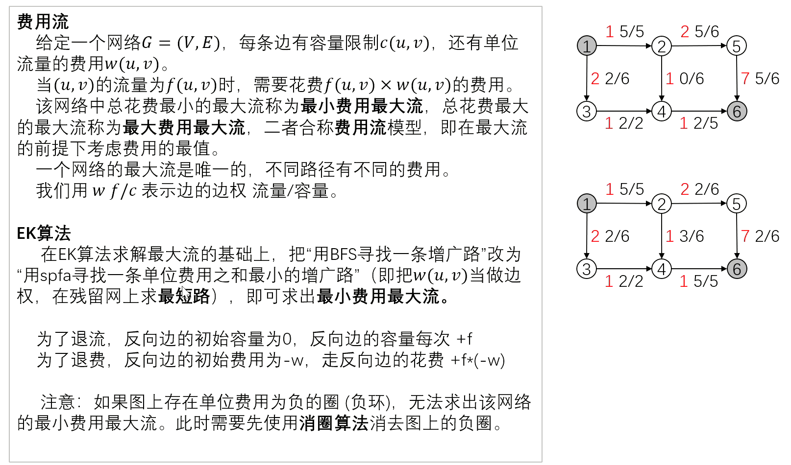

### 题目情境

题目链接：https://www.luogu.com.cn/problem/P3381

**题目描述**

给出一个包含 $$n$$ 个点和 $$m$$ 条边的有向图（下面称其为网络） $$G=(V,E)$$，该网络上所有点分别编号为 $$1 \sim n$$，所有边分别编号为 $$1\sim m$$，其中该网络的源点为 $$s$$，汇点为 $$t$$，网络上的每条边 $$(u,v)$$ 都有一个流量限制 $$w(u,v)$$ 和单位流量的费用 $$c(u,v)$$。

你需要给每条边 $$(u,v)$$ 确定一个流量 $$f(u,v)$$，要求：

1.  $$0 \leq f(u,v) \leq w(u,v)$$（每条边的流量不超过其流量限制）；
2.  $$\forall p \in \{V \setminus \{s,t\}\}$$，$$\sum_{(i,p) \in E}f(i,p)=\sum_{(p,i)\in E}f(p,i)$$（除了源点和汇点外，其他各点流入的流量和流出的流量相等）；
3.  $$\sum_{(s,i)\in E}f(s,i)=\sum_{(i,t)\in E}f(i,t)$$（源点流出的流量等于汇点流入的流量）。

定义网络 $$G$$ 的流量 $$F(G)=\sum_{(s,i)\in E}f(s,i)$$，网络 $$G$$ 的费用 $$C(G)=\sum_{(i,j)\in E} f(i,j) \times c(i,j)$$。

你需要求出该网络的**最小费用最大流**，即在 $$F(G)$$ 最大的前提下，使 $$C(G)$$ 最小。

**输入格式**

输入第一行包含四个整数 $$n,m,s,t$$，分别代表该网络的点数 $$n$$，网络的边数 $$m$$，源点编号 $$s$$，汇点编号 $$t$$。

接下来 $$m$$ 行，每行四个整数 $$u_i,v_i,w_i,c_i$$，分别代表第 $$i$$ 条边的起点，终点，流量限制，单位流量费用。

**输出格式**

输出两个整数，分别为该网络的最大流 $$F(G)$$，以及在 $$F(G)$$ 最大的前提下，该网络的最小费用 $$C(G)$$。

输入 #1

```
4 5 4 3
4 2 30 2
4 3 20 3
2 3 20 1
2 1 30 9
1 3 40 5
```

输出 #1

```
50 280
```

对于 $$100\%$$ 的数据，$$1 \leq n \leq 5\times 10^3$$，$$1 \leq m \leq 5 \times 10^4$$，$$1 \leq s,t \leq n$$，$$u_i \neq v_i$$，$$0 \leq w_i,c_i \leq 10^3$$，且该网络的最大流和最小费用 $$\leq 2^{31}-1$$。

### 算法解析：



最小费用最大流：在 EK 框架下，每次用 SPFA 在残量网络上找费用最小的增广路，沿最短路增广并累加费用，直到找不到增广路。因为残量网络中存在负费用反向边，用 SPFA 而非 Dijkstra。复杂度 $O(F\cdot nm)$。

邻接表使用 `vector<vector<int>> g` 保存出边编号，边信息存放在 `vector<Edge> e` 中。正反向边连续加入，编号从 0 开始，通过 `i ^ 1` 找反向边；反向边的初始容量为零，费用为正向边费用的相反数。`pre[v]` 记录最短路上进入 `v` 的边编号，以便沿路径更新残量。

### py代码实现

本节给出 C++ 实现。

### C++代码实现

```c++
// Luogu P3381 【模板】最小费用最大流
#include <iostream>
#include <algorithm>
#include <limits>
#include <queue>
#include <vector>
using namespace std;

using LL = long long;
const LL INF = numeric_limits<LL>::max() / 4;
int n, m, S, T;
struct Edge { int to; LL cap, cost; };
vector<Edge> e;
vector<vector<int>> g;
vector<LL> d,mf;
LL flow,cost;
vector<int> pre;
vector<bool> vis;

void add(int a, int b, LL cap, LL w) {
  int id = static_cast<int>(e.size());
  e.push_back({b, cap, w});
  e.push_back({a, 0, -w});
  g[a].push_back(id);
  g[b].push_back(id ^ 1);
}
bool spfa() {
  fill(d.begin(), d.end(), INF);
  fill(mf.begin(), mf.end(), 0);
  fill(vis.begin(), vis.end(), false);
  queue<int> q;
  q.push(S);
  d[S] = 0;
  mf[S] = INF;
  vis[S] = true;
  while (!q.empty()) {
    int u = q.front(); q.pop();
    vis[u] = false;
    for (int id : g[u]) {
      int v = e[id].to;
      if (e[id].cap > 0 && d[v] > d[u] + e[id].cost) {
        d[v] = d[u] + e[id].cost;
        pre[v] = id;
        mf[v] = min(mf[u], e[id].cap);
        if (!vis[v]) {
          q.push(v);
          vis[v] = true;
        }
      }
    }
  }
  return mf[T] > 0;
}
void EK() {
  while (spfa()) {
    for (int v = T; v != S; ) {
      int id = pre[v];
      e[id].cap -= mf[T];
      e[id ^ 1].cap += mf[T];
      v = e[id ^ 1].to;
    }
    flow += mf[T];
    cost += mf[T] * d[T];
  }
}
int main() {
  ios::sync_with_stdio(false);
  cin.tie(nullptr);
  cin >> n >> m >> S >> T;
  g.assign(n + 1, {});
  d.assign(n + 1, 0); mf.assign(n + 1, 0);
  pre.assign(n + 1, 0); vis.assign(n + 1, false);
  for (int i = 0; i < m; ++i) {
    int a, b;
    LL cap, w;
    cin >> a >> b >> cap >> w;
    add(a, b, cap, w);
  }
  EK();
  cout << flow << ' ' << cost << '\n';
  return 0;
}
```
