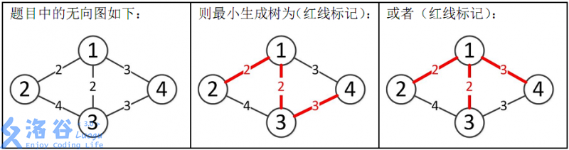
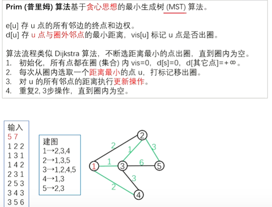
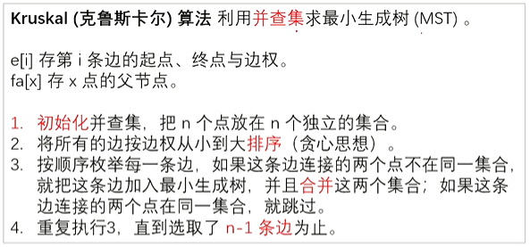

### 题目情境

题目链接：https://www.luogu.com.cn/problem/P3366

**题目描述**

如题，给出一个无向图，求出最小生成树，如果该图不连通，则输出 `orz`。

**输入格式**

第一行包含两个整数 $$N,M$$，表示该图共有 $$N$$ 个结点和 $$M$$ 条无向边。

接下来 $$M$$ 行每行包含三个整数 $$X_i,Y_i,Z_i$$，表示有一条长度为 $$Z_i$$ 的无向边连接结点 $$X_i,Y_i$$。

**输出格式**

如果该图连通，则输出一个整数表示最小生成树的各边的长度之和。如果该图不连通则输出 `orz`。

**输入输出样例 #1**

输入 #1

```
4 5
1 2 2
1 3 2
1 4 3
2 3 4
3 4 3
```

输出 #1

```
7
```

对于 $$100\%$$ 的数据：$$1\le N\le 5000$$，$$1\le M\le 2\times 10^5$$，$$1\le Z_i \le 10^4$$。


样例解释：

  

所以最小生成树的总边权为 $$2+2+3=7$$。

### 算法解析：

Prim算法（$$O(n^2)$$）：



Kruscal算法（$$O(mlogm)$$）：



Kruskal 求最小生成树：把所有边按边权升序排序，依次尝试加入，若边的两端点当前不连通（并查集不同集合）则加入，直到连成 $n-1$ 条边；若最终边数不足 $n-1$ 说明图不连通（输出 orz）。复杂度 $O(m\log m)$。Prim 则从一点出发，每次用堆取当前到集合的最小边加点，适合稠密图。

### Python代码实现

```python

class Edge():
    def __init__(self, v, w):
        self.v = v
        self.w = w

def prim(s):
    global ans, cnt
    for i in range(n + 1):
        d[i] = int(1e9)
    d[s] = 0
    for i in range(1, n + 1):
        u = 0
        for j in range(1, n + 1):
            if not vis[j] and d[j] < d[u]:
                u = j
        vis[u] = 1
        ans += d[u]
        if d[u] != 1e9:
            cnt += 1
        for ed in e[u]:
            v = ed.v
            w = ed.w
            if d[v] > w:
                d[v] = w
    return cnt == n
n, m = map(int, input().split())
d = [0] * (n + 1)
vis = [0] * (n + 1)
e = [[] for _ in range(n + 1)]
ans, cnt = 0, 0
for i in range(m):
    a, b, c = map(int, input().split())
    e[a].append(Edge(b, c))
    e[b].append(Edge(a, c))
if not prim(1):
    print("orz")
else:
    print(ans)
```

### Kruskal 版（Python）

```python
class Edge():
    def __init__(self, u, v, w):
        self.u = u
        self.v = v
        self.w = w

def find(x):
    if fa[x] == x:
        return x
    fa[x] = find(fa[x])
    return fa[x]
def union(x, y):
    fa[find(x)] = find(y)
def kruskal():
    global ans, cnt
    e.sort(key=lambda k:k.w)
    for i in range(m):
        x = find(e[i].u)
        y = find(e[i].v)
        if x != y:
            union(x, y)
            ans += e[i].w
            cnt += 1
    return cnt == n - 1

n, m = map(int, input().split())
fa = [i for i in range(n + 1)]
ans, cnt = 0, 0
e = []
for i in range(m):
    u, v, w = map(int, input().split())
    e.append(Edge(u, v, w))
if not kruskal():
    print("orz")
else:
    print(ans)
```

### C++代码实现

```c++
// Luogu P3366 【模板】最小生成树
#include <iostream>
#include <cstring>
#include <algorithm>
#include <vector>
#define inf 1e9
using namespace std;

int n,m,a,b,c,ans,cnt;
struct edge{int v,w;};
vector<vector<edge>> e;
vector<int> d,vis;

bool prim(int s){
  for(int i=0;i<=n;i++)d[i]=inf;
  d[s]=0;
  for(int i=1;i<=n;i++){
    int u=0;
    for(int j=1;j<=n;j++)
      if(!vis[j]&&d[j]<d[u]) u=j;
    vis[u]=1; //标记u已出圈
    ans+=d[u];
    if(d[u]!=inf) cnt++;
    for(auto ed : e[u]){
      int v=ed.v, w=ed.w;
      if(d[v]>w) d[v]=w;
    }
  }
  return cnt==n;
}
int main(){
  cin>>n>>m;
  e.assign(n+1,{});
  d.assign(n+1,0);
  vis.assign(n+1,0);
  for(int i=0; i<m; i++){
    cin>>a>>b>>c;
    e[a].push_back({b,c});
    e[b].push_back({a,c});
  }
  if(!prim(1))puts("orz");
  else printf("%d\n",ans);
  return 0;
}
```

### Kruskal 版（C++）

```c++
// Luogu P3366 【模板】最小生成树
#include <iostream>
#include <cstring>
#include <algorithm>
#include <vector>
using namespace std;

int n, m;
struct edge{
  int u,v,w;
  bool operator<(const edge &t)const
  {return w < t.w;}
};
vector<edge> e;
struct DSU{
  vector<int> fa;
  explicit DSU(int n){
    fa.resize(n+1);
    for(int i=0;i<=n;i++) fa[i]=i;
  }
  int find(int x){
    if(fa[x]==x) return x;
    return fa[x]=find(fa[x]);
  }
  bool unite(int x,int y){
    x=find(x),y=find(y);
    if(x==y) return false;
    fa[x]=y;
    return true;
  }
};
int ans,cnt;

bool kruskal(){
  sort(e.begin(),e.end());
  DSU dsu(n);
  for(int i=0; i<m; i++){
    if(dsu.unite(e[i].u,e[i].v)){
      ans+=e[i].w;
      cnt++;
    }
  }
  return cnt==n-1;
}
int main(){
  cin>>n>>m;
  e.resize(m);
  for(int i=0; i<m; i++)
    cin>>e[i].u>>e[i].v>>e[i].w;
  if(!kruskal()) puts("orz");
  else printf("%d\n",ans);
  return 0;
}
```
