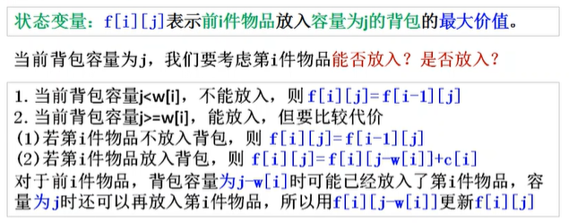

### 题目情境

题目链接：https://www.luogu.com.cn/problem/P1616

题目不码了，跟上题一样，只不过是把只能拿一件物品改为可以拿任意件。

### 算法解析：

完全背包与 01 背包的区别是每种物品可以取任意多件。用一维数组 $f[j]$ 表示容量 $j$ 的最大价值，容量**正序遍历**（$j$ 从小到大），这样 $f[j-w]$ 可能已经是本物品更新过的值，从而支持无限取用。$f[j]=\max(f[j], f[j-w]+v)$，复杂度 $O(nm)$。



### Python代码实现

```python
n, m = map(int, input().split())
v = [0] * (n + 1)
w = [0] * (n + 1)
f = [0] * (m + 1)
for i in range(n):
    v[i + 1], w[i + 1] = map(int, input().split())
for i in range(1, n + 1):
    for j in range(v[i], m + 1):
        f[j] = max(f[j], f[j - v[i]] + w[i])
print(f[m])
```

### C++代码实现

```c++
// 优化决策+优化空间
#include <iostream>
#include <cstring>
#include <algorithm>
#include <vector>
using namespace std;

int n, m;

int main(){
  scanf("%d%d",&n,&m);
  vector<int> v,w;
  v.assign(n + 1, 0);
  w.assign(n + 1, 0);
  vector<long long> f;
  f.assign(m + 1, 0);
  for(int i=1; i<=n; i++)
    scanf("%d%d",&v[i],&w[i]);  //费用，价值

  for(int i=1; i<=n; i++)       //枚举物品
    for(int j=v[i]; j<=m; j++)  //枚举体积
      f[j]=max(f[j],f[j-v[i]]+w[i]);

  printf("%lld\n",f[m]);
}
```
