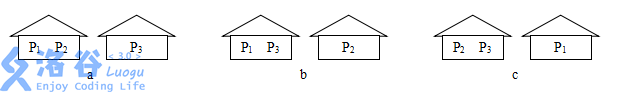
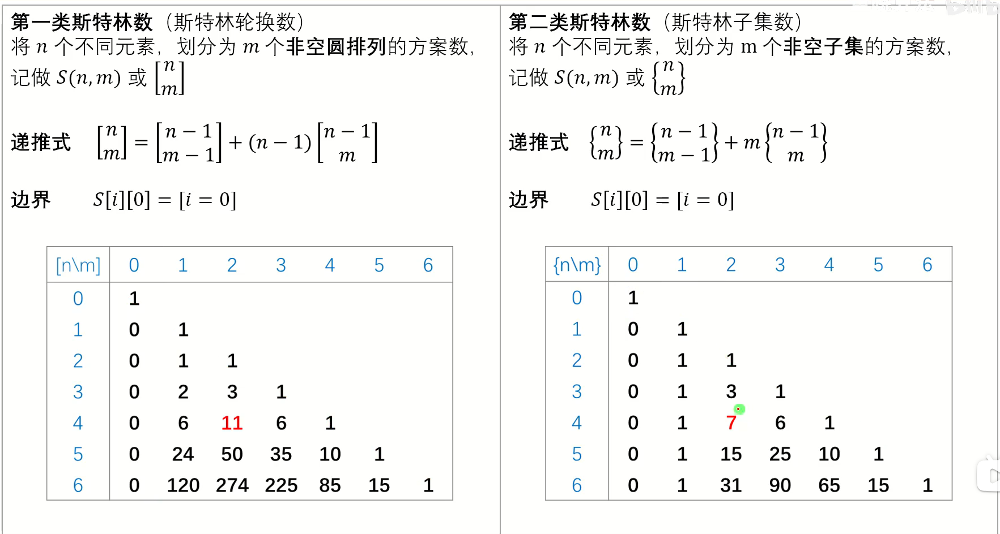

### 题目情境

**题目描述**

为了自己的安全，小猪们又建造了一个新砖房。但是现在问题出现了，怎样把三个小猪分配到两个房子里呢？第三只小猪是三只小猪中最聪明的一只，为了不浪费任何一个房子，它总共考虑了三种方案，如下图

  

“但是将来怎么办呢？”第三只小猪知道将来随着成员的增多，它们将会盖更多的房子。它想知道给定了房子和猪的数目后，房子的分配方案有多少，但这个问题对于它来说，很明显有点难了，你能帮小猪解决这个问题吗？

**输入格式**

输入数据仅有一行，包含两个整数 $n$ 和 $m$，分别表示小猪的数目和房间数（$1\leq n, m \leq 50$）。

**输出格式**

输出数据应为一个整数，表示将 $n$ 只小猪安置在 $m$ 个房间且没有房间空闲的方案数。

输入 #1

```
4 2
```

输出 #1

```
7
```

输入 #2

```
6 7
```

输出 #2

```
0
```

### 算法解析：

第二类斯特林数 $S(n,k)$ 表示把 $n$ 个不同元素分成 $k$ 个非空集合的方案数。递推式：$S(n,k)=S(n-1,k-1)+kS(n-1,k)$——新元素单独成一个集合，或放入已有 $k$ 个集合中的任意一个。边界 $S(0,0)=1,\ S(n,0)=0\ (n>0)$。与第一类斯特林数的区别：集合无顺序，圆排列有顺序。

打表找到规律后直接使用。



### C++代码：

```c++
#include <iostream>
#include <algorithm>
#include <vector>
using namespace std;

int main(){
  int n,m; cin>>n>>m;
  if(m>n){cout<<0; return 0;}
  using Digits=vector<int>; //十进制低位在前，位数随进位增长
  vector<vector<Digits>> S;
  S.assign(n+1,vector<Digits>(m+1));
  S[0][0]={1};
  for(int i=1;i<=n;i++)
    for(int j=1;j<=min(i,m);j++){
      const auto& a=S[i-1][j-1];
      const auto& b=S[i-1][j];
      auto& cur=S[i][j];
      cur.assign(max(a.size(),b.size()),0);
      int carry=0;
      for(size_t k=0;k<cur.size();k++){
        int value=carry+(k<a.size()?a[k]:0)+j*(k<b.size()?b[k]:0);
        cur[k]=value%10;
        carry=value/10;
      }
      while(carry){cur.push_back(carry%10); carry/=10;}
    }
  if(S[n][m].empty()) cout<<0;
  else for(auto it=S[n][m].rbegin();it!=S[n][m].rend();++it) cout<<*it;
}
```