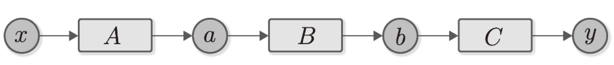
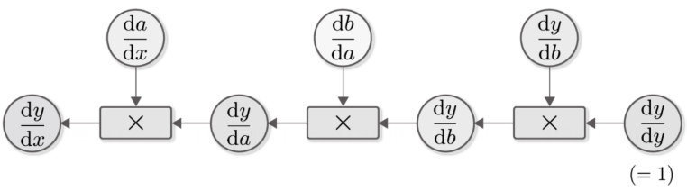
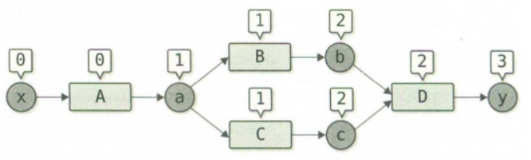

## 1. 变量与函数

### 1.1 变量（Variable）

我们先从最核心的部分开始——变量类（Variable）。
还记得 PyTorch 和 TensorFlow 吗？它们的底层核心都是 Tensor。在我们的实现中，也会有类似的概念，只不过底层我们用的是 numpy.ndarray。所有的运算都基于它来完成。
那问题来了：既然 NumPy 已经能做广播、求和、矩阵乘法这些操作，为什么还要自己再封装一层“变量类”呢？
确实，用 NumPy 我们也能写出各种计算，但它有一个致命的限制——NumPy 不会记录你的计算过程。也就是说，它不知道你是怎么一步步算出结果的，更别提反向传播或者自动求导了。
而我们定义“变量类”的意义就在这里。它不只是一个装数据的容器，而是一个能“记住”自己经历过哪些运算的智能变量。有了它，我们就能自动构建计算图，实现一系列自动化的操作，比如梯度计算、参数更新等等。

```python
import numpy as np

class Variable:
    def __init__(self, data):
        self.data = data
        
data = np.array(1.0)
x = Variable(data)
print(x.data)
```

### 1.2 函数（Function）

先抛个问题：什么是函数？
比如$$f(x)=x^2$$这算不算函数？当然算！这是一个最基础的形式——从一个变量映射到另一个变量。
不过，现实中我们经常会遇到更复杂的函数。比如 sum()，它的输入是多个值，输出却是一个值，这就属于多对一的函数。而且这类函数通常还涉及到数据维度的变化，稍微麻烦一点，我们后面再慢慢讲。现在，我们先从简单的单变量函数入手。
前面我们说过，定义“变量类”的目的，是为了能记录计算过程。那同理，如果我们想要整个计算图完整、可追踪，函数的计算过程也得被“记住”。这意味着什么？——函数也要被实例化！
不过，函数有很多种：平方、加法、乘法、求和、指数……每一种都有自己的逻辑。如果一个个单独写，那代码会一团糟。
因此我们需要定义一个函数的父类（Function），然后让各种具体运算（eg. Add、Mul、Square ）去继承它：

```python
import numpy as np

class Variable:
    def __init__(self, data):
        self.data = data

class Function:
    def __call__(self, input):
        x = input.data
        y = self.forward(x)
        output = Variable(y)
        return output
    
    def forward(self,x):
        raise NotImplementedError
                
class Square(Function):
    def forward(self, x):
        return x ** 2

def square(x):
    return Square()(x)

if __name__ == "__main__":
    import numpy as np
    x = Variable(np.array(6))
    y = square(x)
    print(y.data)
```

解释一下：__call__ 是一个特殊方法，允许一个对象像函数一样被调用。怎么说呢？等价于隐藏了.__call__()函数，然后使用y = square(x)的时候，先调用了Square里从Function那里继承来的__call__，再利用call内部的forward执行自己的forward。
有一个需要注意的是，我们说过，ndarray执行的是计算功能，所以，定义函数时候的forward的输入不是Variable类型，而是ndarray类型。而执行函数的时候还是输入Variable类型。
还有就是，定义square(x)函数的主要目的是符合我们的习惯，这样可以不用定义两个括号。

## 2. 反向传播与计算图

<div id="2-纯链式正向传播与反向传播"></div>

### 2.1 链式前向与反向传播

对于正向传播，其实我们只需要这么做就行了：square(square(square(x)))不就得了，这样就能很自然地一层一层执行下去......当然，也不一定是square函数，这里只是举个例子，其实换成其他的也行，比如add(exp(x)+exp(y))。
然后我们来研究一下反向传播。
首先，先提出一个概念，叫做计算图，我们之前提到过，它可以长这样：


假如我们拥有变量y，并且要对x求导的话，由链式法则，有：$$\begin{aligned} \frac{\mathrm{d}y}{\mathrm{d}x}=\frac{\mathrm{d}y}{\mathrm{d}y}\frac{\mathrm{d}y}{\mathrm{d}b}\frac{\mathrm{d}b}{\mathrm{d}a}\frac{\mathrm{d}a}{\mathrm{d}x} \end{aligned}$$，即：



我们把$$\begin{aligned} \frac{\mathrm{d}?}{\mathrm{d}?} \end{aligned}$$叫做梯度，在Variable类里添加grad这个属性，类型是ndarray，这一点我相信大家并不会陌生。
首先明确一件事情，我们需要知道什么才能计算梯度$$\begin{aligned} \frac{\mathrm{d}y}{\mathrm{d}x} \end{aligned}$$？我们知道前向过程的输入的变量。举个例子,$$y = x ^ 2$$知道$$x = 5$$之后，就能知道$$\begin{aligned} \frac{\mathrm{d}y}{\mathrm{d}x}=2x=10 \end{aligned}$$了。所以我们需要在Fuction类中添加input属性加以记录就行，然后此次算出来乘起来就行，Fuction的每个函数添加一个backword方法计算。
接下来就是，怎样记录这个计算图？从刚刚的反向传播的步骤我们不难知道这是一个类似链表一样的东西，把变量和函数都视作节点，记住它们的前驱就行了！所以现在你可以回答Fuction类中input属性是什么了，没错，是Variable类型。同理，我们需要记住变量的前驱，在Variable类型里添加creator属性就行，同理，这个属性的类型是函数类型。
我们还有一件事，假如我们顺利地处理出了所有的梯度，但是我们最后要求的可不只是每个的梯度，还有它们梯度的乘积，所以为了把“后面的变量的梯度”传递到前面，我们再给Fuction类添加一个output属性，这样后面的grad就能自然的在反向的时候向前推动了。
对于y = square(exp(square(x)))我们能轻松实现这一过程：

```python
import numpy as np

class Variable:
    def __init__(self, data):
        self.data = data
        self.grad = None
        self.creator = None

    def set_creator(self, func):
        self.creator = func

    def backward(self):
        if self.grad is None:
            self.grad = np.ones_like(self.data)

        funcs = [self.creator]
        while funcs:
            f = funcs.pop()
            x, y = f.input, f.output
            x.grad = f.backward(y.grad)

            if x.creator is not None:
                funcs.append(x.creator)

def as_array(x):
    if np.isscalar(x):
        return np.array(x)
    return x

class Function:
    def __call__(self, input):
        x = input.data
        y = self.forward(x)
        output = Variable(as_array(y))
        output.set_creator(self)
        self.input = input
        self.output = output
        return output

    def forward(self, x):
        raise NotImplementedError()

    def backward(self, gy):
        raise NotImplementedError()


class Square(Function):
    def forward(self, x):
        y = x ** 2
        return y

    def backward(self, gy):
        x = self.input.data
        gx = 2 * x * gy
        return gx


class Exp(Function):
    def forward(self, x):
        y = np.exp(x)
        return y

    def backward(self, gy):
        x = self.input.data
        gx = np.exp(x) * gy
        return gx


def square(x):
    return Square()(x)


def exp(x):
    return Exp()(x)


x = Variable(np.array(0.5))
y = square(exp(square(x)))
y.backward()
print(x.grad)
```

<div id="3-可变数参数"></div>

### 2.2 多输入与多输出

前面我们研究的是链式的计算图，接下来我们研究一下多链式图（即“相对链式”，输入之后就是输出的那种图，但是输入和输出参数的数量会变，即“可变的长参数”，无需考虑拓扑序的那种）。
- 前向过程：
我们来解决一下上面没有解决的问题，也就是add函数，它接受两个输入，但是只返回一个输出！这种函数是存在的。那么，有没有一个输入两个输出的呢？答案是，这也存在。比如把一个矩阵分成两个小矩阵的函数，甚至分成几个相同的矩阵也不是不行。也存在多对多的情况，比如MLP！所以说，我们需要把Function的input和output处理成inputs和outputs。
其实这不难理解，无非就是添加了一个循环而已。不过需要注意的是，我们为了形式上的统一，把单变量也按照列表管理处理，也就是说，内部的流动不存在单个的形式，都有一定的维度，但是输入和输出允许单个，方便我们的习惯。
- 反向过程：
我们的backword函数里，需要进行调整，局部的函数也需要进行调整。
gys是函数是输出层的所有的变量的梯度，利用它们可以“计算”出函数输入层的梯度（这里的“计算”指的是融合，实际上局部梯度只需要函数本身和输入层就够了）。同样道理的，假如gxs是输出维度只有一层就给它套个壳（之前规范过），然后把输入层和输入层的梯度对应上就行了。对应部分的判断主要是应对这种情况：y=add(x, x)。那为啥不初始化为0，直接执行递增呢？设置为None可以节约空间啊！还有一件事，就是，由于py底层问题，此处最好不要使用自加函数哈，会不稳定。
```python
import numpy as np


class Variable:
    def __init__(self, data):
        if data is not None:
            if not isinstance(data, np.ndarray):
                raise TypeError('{} is not supported'.format(type(data)))

        self.data = data
        self.grad = None
        self.creator = None

    def set_creator(self, func):
        self.creator = func

    def cleargrad(self):
        self.grad = None

    def backward(self):
        if self.grad is None:
            self.grad = np.ones_like(self.data)

        funcs = [self.creator]
        while funcs:
            f = funcs.pop()
            gys = [output.grad for output in f.outputs]
            gxs = f.backward(*gys)
            if not isinstance(gxs, tuple):
                gxs = (gxs,)

            for x, gx in zip(f.inputs, gxs):
                if x.grad is None:
                    x.grad = gx
                else:
                    x.grad = x.grad + gx

                if x.creator is not None:
                    funcs.append(x.creator)


def as_array(x):
    if np.isscalar(x):
        return np.array(x)
    return x


class Function:
    def __call__(self, *inputs):
        xs = [x.data for x in inputs]
        ys = self.forward(*xs)
        if not isinstance(ys, tuple):
            ys = (ys,)
        outputs = [Variable(as_array(y)) for y in ys]

        for output in outputs:
            output.set_creator(self)
        self.inputs = inputs
        self.outputs = outputs
        return outputs if len(outputs) > 1 else outputs[0]

    def forward(self, xs):
        raise NotImplementedError()

    def backward(self, gys):
        raise NotImplementedError()


class Add(Function):
    def forward(self, x0, x1):
        y = x0 + x1
        return y

    def backward(self, gy):
        return gy, gy


def add(x0, x1):
    return Add()(x0, x1)

x = Variable(np.array(3.0))
y = add(add(x, x), x)
y.backward()
print(x.grad)
```

<div id="4-true计算图"></div>

### 2.3 分支计算图的反传顺序

其实上一节的假设不太好，我们这里直接引入复杂的计算图吧。计算图的本质上是一个DAG（有向无环图），对于一个DAG，给定起点，一定可以进行拓扑排序。拓扑排序的做法有很多种，比如kahn算法抑或是染色法，我们这里使用Kahn算法，但是不完全是Kahn，个人感觉只是使用了Kahn 算法中的“层次”概念。不了解的自己去搜或者尝试证明以下的方法。
假如我需要处理下面这个图，我们之前的方法可能会y→D→c→C→a→A→x...这样是错的，因为处理a一直到x的时候，b和B都没处理，显然和计算顺序不符。

所以我们使用这个方法：
我们给每个Function还有Variable添加一个generation参数，然后我们在正向传播的时候，假如现在是函数，那么它的输出变量的generation为函数的generation+1。有人可能会问，直接赋值不会受到其他函数的干扰吗？要记住，一个变量只能由一个函数生成！所以不会干扰。函数的generation为它的所有输出层变量的generation的max。具体怎么挑下一个要处理的函数呢？取最大的generation的处理就行了。
理论上，只需要每个Function有 generation就行了，不过为了方便，我们给变量赋值上generation可以利用计算图的完整性，方便执行。

```python
import numpy as np


class Variable:
    def __init__(self, data):
        if data is not None:
            if not isinstance(data, np.ndarray):
                raise TypeError('{} is not supported'.format(type(data)))

        self.data = data
        self.grad = None
        self.creator = None
        self.generation = 0

    def set_creator(self, func):
        self.creator = func
        self.generation = func.generation + 1

    def cleargrad(self):
        self.grad = None

    def backward(self):
        if self.grad is None:
            self.grad = np.ones_like(self.data)

        funcs = []
        seen_set = set()

        def add_func(f):
            if f not in seen_set:
                funcs.append(f)
                seen_set.add(f)
                funcs.sort(key=lambda x: x.generation)

        add_func(self.creator)

        while funcs:
            f = funcs.pop()
            gys = [output.grad for output in f.outputs]
            gxs = f.backward(*gys)
            if not isinstance(gxs, tuple):
                gxs = (gxs,)

            for x, gx in zip(f.inputs, gxs):
                if x.grad is None:
                    x.grad = gx
                else:
                    x.grad = x.grad + gx

                if x.creator is not None:
                    add_func(x.creator)
def as_array(x):
    ......

class Function:
    def __call__(self, *inputs):
        xs = [x.data for x in inputs]
        ys = self.forward(*xs)
        if not isinstance(ys, tuple):
            ys = (ys,)
        outputs = [Variable(as_array(y)) for y in ys]

        self.generation = max([x.generation for x in inputs])
        for output in outputs:
            output.set_creator(self)
        self.inputs = inputs
        self.outputs = outputs
        return outputs if len(outputs) > 1 else outputs[0]
......
```
seen_set的意思是，目前添加过哪些函数，就不能二次添加了。每次添加函数之后进行一轮sort，看似复杂度爆炸，实则模型里的函数数目其实比变量少多了，这点复杂度不需要节约，加个优先队列反而需要占用更多空间。

<div id="5-一些必要的优化"></div>

## 3. 自动微分引擎的优化

### 3.1 弱引用与循环引用

Python使用两种方式管理内存，一种是引用计数，另外一种是分代垃圾回收。引用计数的原理很简单，当它被另一个对象引用的时候，引用计数+1，停止引用时，引用计数-1。引用计数为0时，Python解释器会回收该对象。这很智能，但是它不能处理循环引用，所以单纯设置None无法解决这个内存问题。不过分代垃圾回收机制可以解决这个问题，具体原理很复杂这里不多说了。他会在内存不足的时候自动调用，也可以gc.collect()主动调用。
在 Python 中，我们可以使用 weakref.ref 函数来创建弱引用。弱引用是在不增加引用计数的情况下引用另一个对象的功能。我们需要破除右侧的循环，可以给outputs打上weakref，就可以自动破除了。weakref的引用方式是后面加个"()"。

```python
while funcs:
    f = funcs.pop()
    gys = [output().grad for output in f.outputs]  # output is weakref
    ......
        if x.creator is not None:
            add_func(x.creator)
    ......
    class Function:
    def __call__(self, *inputs):
        ......
        self.inputs = inputs
        self.outputs = [weakref.ref(output) for output in outputs] # output is weakref
        return outputs if len(outputs) > 1 else outputs[0]
```

### 3.2 中间梯度与计算图

反向传播时，已经用过的中间梯度通常可以释放。`backward()` 可以提供一个开关，在需要检查这些梯度时保留它们。

只做推理时，可以用 `no_grad()` 临时关闭计算图记录。`contextlib.contextmanager` 能把这个开关限制在一段 `with` 语句内。后面的训练示例会用到它。

### 3.3 变量属性与运算符重载

有一点需要明确，虽然我们使用了numpy的ndarray作为计算底层，那么我们为何不整一个numpy-plus呢？简单来说，我们可以添加一些函数让它更加易用！
numpy里有个东西叫做x.shape，这里我们实现一下：
```python
@property
def shape(self):
    return self.data.shape
```
dtype，ndim，size同理，len可以重载__len__实现，print可以重载__repr__实现，这里不赘述了，包括运算符的重载。
有个需要注意的是，由于函数是实例化的，它可以存东西。这一点很重要，后续的矩阵运算也依赖维度的信息存储。比如幂函数：
```python
class Pow(Function):
    def __init__(self, c):
        self.c = c
    def forward(self, x):
        y = x ** self.c
        return y
    def backward(self, gy):
        x = self.inputs[0].data
        c = self.c
        gx = c * x ** (c - 1) * gy
        return gx
def pow(x, c):
    return Pow(c)(x)
Variable.__pow__ = pow
```

原书有绘制计算图以及求高阶导数等步骤，在这里我们将掠过，这部分内容不需要。

<div id="6-可变长参数"></div>

## 4. 张量运算

第 2 节讨论的是算子接收和返回多少个 `Variable`。这一节看单个 `Variable` 里的数组形状如何变化，以及反传时怎样得到与各个输入形状一致的梯度。

### 4.1 形状变换（Reshape）

回忆一下，我们之前讲幂次函数的时候，我们说过，要记录一个东西是吧，也就是幂次本身。我们的reshape函数同理，要记录一下原来的维度（x_shape）以及改变后的维度(shape)。numpy里自带了reshape函数，所以计算过程直接使用就行。对于反向过程，我们直接reshape回去就行，梯度数值不需要进行处理。

```python
class Reshape(Function):
    def __init__(self, shape):
        self.shape = shape

    def forward(self, x):
        self.x_shape = x.shape
        y = x.reshape(self.shape)
        return y

    def backward(self, gy):
        return reshape(gy, self.x_shape)
        
def reshape(x, shape):
    if x.shape == shape:
        return as_variable(x)
    return Reshape(shape)(x)
```
使用方法比较反人类：y = F.reshape(x,(6,))，而我们平时可能使用惯了y = x.reshape(2, 3)这样，所以我们可以修改一下Variable类，去实现这个便捷设计（略）。

### 4.2 矩阵乘法（MatMul）

令 $Y = AB$，其中 $A \in \mathbb{R}^{m\times n}$，$B \in \mathbb{R}^{n\times p}$，$Y \in \mathbb{R}^{m\times p}$。
设上游标量损失为 $L$，并记梯度矩阵 $G = \frac{\partial L}{\partial Y} \in \mathbb{R}^{m\times p}$。则

$$
\boxed{\frac{\partial L}{\partial A} = G\,B^{\mathsf{T}}}
\qquad
\boxed{\frac{\partial L}{\partial B} = A^{\mathsf{T}}\,G}
$$

推导时，先把 $Y$ 的每个元素写成求和形式。

$$
Y_{ij} = \sum_k A_{ik} B_{kj}
$$

对 $A_{uv}$ 应用链式法则，得到

$$
\begin{aligned}
\frac{\partial L}{\partial A_{uv}}
&= \sum_{i,j} \frac{\partial L}{\partial Y_{ij}} \frac{\partial Y_{ij}}{\partial A_{uv}} \\
&= \sum_{i,j} G_{ij}\,\delta_{iu}\,B_{vj} \\
&= \sum_j G_{uj} B_{vj}.
\end{aligned}
$$

写成矩阵形式就是 $\frac{\partial L}{\partial A} = G B^{\mathsf{T}}$。

对 $B_{uv}$ 同理。

$$
\begin{aligned}
\frac{\partial L}{\partial B_{uv}}
&= \sum_{i,j} \frac{\partial L}{\partial Y_{ij}} \frac{\partial Y_{ij}}{\partial B_{uv}} \\
&= \sum_{i,j} G_{ij}\,A_{iu}\,\delta_{jv} \\
&= \sum_i A_{iu} G_{iv}.
\end{aligned}
$$

对应的矩阵形式为 $\frac{\partial L}{\partial B} = A^{\mathsf{T}} G$。下面用这两个式子实现 `MatMul.backward()`。

```python
class MatMul(Function):
    def forward(self, x, W):
        y = x.dot(W)
        return y

    def backward(self, gy):
        x, W = self.inputs
        gx = matmul(gy, W.T)
        gW = matmul(x.T, gy)
        return gx, gW


def matmul(x, W):
    return MatMul()(x, W)
```

<div id="7-神经网络与框架搭建"></div>

## 5. 神经网络与框架搭建

矩阵乘法能把一批输入一次映射到输出。再加上偏置、损失和参数更新，就能训练第一个模型。运行本章示例时，先展开下面的一阶自动微分核心，再按顺序把 Python 代码块放进同一个文件。

<details>
<summary>运行示例所需的一阶自动微分核心</summary>

这里的算子有多个输入和一个输出，`forward()` 和 `backward()` 都在数组上计算。

```python
from contextlib import contextmanager
from contextvars import ContextVar
from math import prod
from weakref import ref

import numpy as np

try:
    import cupy as cp
except ImportError:
    cp = None


def array_module(array):
    return cp if cp is not None and isinstance(array, cp.ndarray) else np


record_grad = ContextVar("record_grad", default=True)


@contextmanager
def no_grad():
    token = record_grad.set(False)
    try:
        yield
    finally:
        record_grad.reset(token)


class Variable:
    def __init__(self, data):
        self.data = array_module(data).asarray(data)
        self.grad = None
        self.creator = None
        self.generation = 0

    def cleargrad(self):
        self.grad = None

    def backward(self):
        if self.grad is None:
            self.grad = array_module(self.data).ones_like(self.data)
        funcs, seen = [], set()

        def add_func(func):
            if func is not None and func not in seen:
                seen.add(func)
                funcs.append(func)
                funcs.sort(key=lambda f: f.generation)

        add_func(self.creator)
        while funcs:
            func = funcs.pop()
            output = func.output()
            grads = func.backward(output.grad)
            if not isinstance(grads, tuple):
                grads = (grads,)
            for variable, grad in zip(func.inputs, grads):
                variable.grad = grad if variable.grad is None else variable.grad + grad
                add_func(variable.creator)
            if output is not self:
                output.cleargrad()


class Function:
    def __call__(self, *inputs):
        xp = array_module(inputs[0].data)
        if any(array_module(x.data) is not xp for x in inputs):
            raise ValueError("All inputs must use the same array module")
        data = self.forward(*(x.data for x in inputs))
        output = Variable(xp.asarray(data))
        if record_grad.get():
            self.inputs = inputs
            self.output = ref(output)
            self.generation = max(x.generation for x in inputs)
            output.creator = self
            output.generation = self.generation + 1
        return output
```

</details>

<div id="71-线性回归"></div>

### 5.1 线性回归

设输入 $X$ 的形状为 $(N,D)$，$W$ 为 $(D,K)$，$b$ 为 $(K,)$。预测值 $XW+b$ 有 $N$ 行，每行加的是同一份偏置。矩阵乘法沿用上一节的反传公式。偏置被广播了 $N$ 次，所以反传时要沿着批次维度求和。

$$
\hat Y=XW+b, \qquad
\frac{\partial L}{\partial b_j}=\sum_{i=1}^{N}\frac{\partial L}{\partial \hat Y_{ij}}.
$$

用均方误差量出预测值与目标的差距，再让权重和偏置沿各自的负梯度方向走一步。每轮先清空参数梯度，因为同一个参数可能在图中被多次使用，`backward()` 会把各条路径给出的梯度相加。

```python
class Affine(Function):
    def forward(self, x, weight, bias):
        return x @ weight + bias

    def backward(self, gy):
        x, weight, _ = (v.data for v in self.inputs)
        return gy @ weight.T, x.T @ gy, gy.sum(axis=0)


class MeanSquaredError(Function):
    def forward(self, prediction, target):
        self.diff = prediction - target
        return (self.diff ** 2).mean()

    def backward(self, gy):
        grad = gy * (2 / self.diff.size) * self.diff
        return grad, -grad


rng = np.random.default_rng(42)
x = Variable(rng.uniform(-1, 1, (128, 1)))
y = Variable(2 * x.data + 1)
weight = Variable(np.zeros((1, 1)))
bias = Variable(np.zeros(1))

for _ in range(100):
    prediction = Affine()(x, weight, bias)
    loss = MeanSquaredError()(prediction, y)
    for variable in (x, y, weight, bias):
        variable.cleargrad()
    loss.backward()
    for param in (weight, bias):
        param.data -= 0.1 * param.grad

print(weight.data.item(), bias.data.item())  # 约 2.0 和 1.0
```

<div id="72-参数层"></div>

### 5.2 参数与线性层

`Variable` 既能表示一批输入，也能表示权重。给可训练权重一个 `Parameter` 类型，层就可以按类型找出要交给优化器的变量。下面把参数和子层都注册成对象属性。带名字的遍历也给保存权重提供了像 `hidden.weight` 这样的路径。

```python
class Parameter(Variable):
    pass


class Layer:
    training = True

    def __call__(self, *inputs):
        return self.forward(*inputs)

    def named_parameters(self):
        seen = set()

        def walk(layer, prefix):
            if id(layer) in seen:
                return
            seen.add(id(layer))
            for name, value in vars(layer).items():
                path = f"{prefix}{name}"
                if isinstance(value, Layer):
                    yield from walk(value, f"{path}.")
                elif isinstance(value, Parameter) and id(value) not in seen:
                    seen.add(id(value))
                    yield path, value

        yield from walk(self, "")

    def parameters(self):
        for _, param in self.named_parameters():
            yield param

    def train(self, mode=True):
        self.training = mode
        for value in vars(self).values():
            if isinstance(value, Layer):
                value.train(mode)
        return self

    def eval(self):
        return self.train(False)


class Linear(Layer):
    def __init__(self, in_size, out_size, rng):
        weights = rng.standard_normal((in_size, out_size)) / np.sqrt(in_size)
        self.weight = Parameter(weights.astype(np.float32))
        self.bias = Parameter(np.zeros(out_size, dtype=np.float32))

    def forward(self, x):
        return Affine()(x, self.weight, self.bias)
```

<div id="73-汇总层"></div>

### 5.3 组合网络层（MLP）

模型本身也可以是一层。把两个 `Linear` 挂到同一个对象上，外层就能递归收集参数并切换训练模式。两个线性层直接相接仍是一次仿射变换，中间加上 `tanh` 后，模型就能拟合非线性的决策边界。

```python
class Tanh(Function):
    def forward(self, x):
        self.y = array_module(x).tanh(x)
        return self.y

    def backward(self, gy):
        return gy * (1 - self.y ** 2)


class MLP(Layer):
    def __init__(self, seed=0):
        rng = np.random.default_rng(seed)
        self.hidden = Linear(2, 16, rng)
        self.output = Linear(16, 2, rng)

    def forward(self, x):
        hidden = Tanh()(self.hidden(x))
        return self.output(hidden)
```

<div id="74-optimizer-更新参数"></div>

### 5.4 优化器（SGD）

把学习率和更新公式收进优化器。模型负责给出参数，反传负责填好梯度，SGD 负责原地更新参数数组。遇到本轮没有参与计算的参数就跳过。

```python
class SGD:
    def __init__(self, model, lr):
        self.model = model
        self.lr = lr

    def zero_grad(self):
        for param in self.model.parameters():
            param.cleargrad()

    def step(self):
        for param in self.model.parameters():
            if param.grad is not None:
                param.data -= self.lr * param.grad
```

<div id="75-损失函数"></div>

### 5.5 损失函数

线性回归用均方误差。做二分类时，模型为每个样本输出两个分数，也就是 logits。把 softmax 和交叉熵放在同一个算子里，先减去每行最大的 logit，再用 log-sum-exp 求目标类别的负对数概率。这样既避免指数溢出，也省去先求概率再直接取对数的步骤。

$$
L=-\frac{1}{N}\sum_{i=1}^{N}\log p_{i,t_i},
\qquad
\frac{\partial L}{\partial z_{ij}}=\frac{p_{ij}-\mathbf{1}_{j=t_i}}{N}.
$$

```python
class SoftmaxCrossEntropy(Function):
    def __init__(self, labels):
        self.labels = labels

    def forward(self, logits):
        xp = array_module(logits)
        self.rows = xp.arange(logits.shape[0])
        self.labels = xp.asarray(self.labels)
        shifted = logits - logits.max(axis=1, keepdims=True)
        exp = xp.exp(shifted)
        total = exp.sum(axis=1, keepdims=True)
        self.prob = exp / total
        log_prob = shifted - xp.log(total)
        return -log_prob[self.rows, self.labels].mean()

    def backward(self, gy):
        grad = self.prob.copy()
        grad[self.rows, self.labels] -= 1
        return gy * (grad / len(self.rows))
```

这里约定 `logits` 的形状是 `(N, C)`，标签是长度为 `N`、取值在 `[0, C)` 的整数数组。反传只在真实类别的位置减 1，省去了构造 one-hot 矩阵。

<div id="76-datasets"></div>

### 5.6 数据集（Dataset）

数据集只定义如何按索引取得一对输入和标签。这里用一个 XOR 数据集来检验模型。两个坐标同号时记为类别 1，异号时记为类别 0。用不同随机种子生成训练集和测试集。

```python
class ArrayDataset:
    def __init__(self, inputs, labels):
        if len(inputs) != len(labels):
            raise ValueError("Inputs and labels must have the same length")
        self.inputs = inputs
        self.labels = labels

    def __len__(self):
        return len(self.labels)

    def __getitem__(self, index):
        return self.inputs[index], self.labels[index]


def xor_dataset(size, seed):
    rng = np.random.default_rng(seed)
    inputs = rng.uniform(-1, 1, (size, 2)).astype(np.float32)
    labels = (inputs[:, 0] * inputs[:, 1] > 0).astype(np.int64)
    return ArrayDataset(inputs, labels)
```

<div id="77-dataloader"></div>

### 5.7 批量加载（DataLoader）

DataLoader 负责每轮打乱索引并把样本组成小批量。末尾不足一批的数据也照常使用。这个数据集支持数组索引，可以一次取出整批特征和标签。

```python
class DataLoader:
    def __init__(self, dataset, batch_size, shuffle=False, seed=0):
        if batch_size < 1:
            raise ValueError("Batch size must be positive")
        self.dataset = dataset
        self.batch_size = batch_size
        self.shuffle = shuffle
        self.rng = np.random.default_rng(seed)

    def __iter__(self):
        size = len(self.dataset)
        indices = self.rng.permutation(size) if self.shuffle else np.arange(size)
        for start in range(0, size, self.batch_size):
            yield self.dataset[indices[start:start + self.batch_size]]


def train_epoch(model, optimizer, loader, xp=np):
    model.train()
    for inputs, labels in loader:
        optimizer.zero_grad()
        logits = model(Variable(xp.asarray(inputs)))
        loss = SoftmaxCrossEntropy(labels)(logits)
        loss.backward()
        optimizer.step()


model = MLP()
optimizer = SGD(model, lr=0.2)
train_loader = DataLoader(xor_dataset(512, seed=1), 32, shuffle=True)

for _ in range(60):
    train_epoch(model, optimizer, train_loader)

test_x, test_y = xor_dataset(256, seed=2)[:]
model.eval()
with no_grad():
    predicted = model(Variable(test_x)).data.argmax(axis=1)
print("Test accuracy:", (predicted == test_y).mean())
```

<div id="8-关键组件与框架拓展"></div>

## 6. 关键组件与框架拓展

<div id="81-使用-gpu"></div>

### 6.1 使用 GPU

前面的算子从输入数组决定用 NumPy 还是 CuPy，梯度的初始值也在同一个设备上创建。切换设备时要一起移动所有参数，并在每批前向计算之前把输入传到同一个设备。标签会在交叉熵内部转换，DataLoader 可以继续在 CPU 上取样本。

```python
def to_numpy(data):
    if cp is not None and isinstance(data, cp.ndarray):
        return cp.asnumpy(data)
    return data


def to_device(model, xp):
    for param in model.parameters():
        param.data = to_numpy(param.data) if xp is np else xp.asarray(param.data)
        param.cleargrad()
    return model
```

在装好 CuPy 和 CUDA 的机器上，可以用 `to_device(model, cp)` 把参数移到 GPU，再调用 `train_epoch(model, optimizer, train_loader, xp=cp)`。当前 SGD 只引用模型，没有额外的数组状态。带动量的优化器还需要一并迁移速度等状态。

<div id="82-模型的保存与加载"></div>

### 6.2 保存与加载权重

把 `named_parameters()` 给出的参数路径作为键，存成一个 `.npz` 文件。加载前先核对键和形状，确认都匹配后再替换参数数据。这里保留目标模型原本的设备和数据类型，旧梯度则在加载后清空。

```python
def save_weights(model, path):
    arrays = {name: to_numpy(param.data) for name, param in model.named_parameters()}
    with open(path, "wb") as file:
        np.savez_compressed(file, **arrays)


def load_weights(model, path):
    params = dict(model.named_parameters())
    pending = []
    with np.load(path, allow_pickle=False) as weights:
        if set(weights.files) != set(params):
            raise ValueError("Checkpoint parameter names do not match the model")
        for name, param in params.items():
            value = weights[name]
            if value.shape != param.data.shape:
                raise ValueError(f"Unexpected shape for {name}: {value.shape}")
            xp = array_module(param.data)
            pending.append((param, xp.asarray(value, dtype=param.data.dtype)))
    for param, value in pending:
        param.data = value
        param.cleargrad()


save_weights(model, "xor-weights.npz")
restored = MLP(seed=9)
load_weights(restored, "xor-weights.npz")
```

这个文件保存的是权重。恢复时先构建结构相同的模型，优化器状态和训练轮次可以在需要断点续训时另存。

<div id="83-dropout"></div>

### 6.3 Dropout

训练时以概率 $p$ 把一部分激活置零，保留下来的值乘以 $1/(1-p)$，这样激活的期望保持不变。反传要复用同一次前向生成的掩码。切到评估模式后直接返回输入。

```python
class DropoutMask(Function):
    def __init__(self, ratio):
        self.ratio = ratio

    def forward(self, x):
        xp = array_module(x)
        self.scale = (xp.random.random(x.shape) >= self.ratio).astype(x.dtype)
        self.scale /= 1 - self.ratio
        return x * self.scale

    def backward(self, gy):
        return gy * self.scale


class Dropout(Layer):
    def __init__(self, ratio):
        if not 0 <= ratio < 1:
            raise ValueError("Dropout probability must be in [0, 1)")
        self.ratio = ratio

    def forward(self, x):
        return DropoutMask(self.ratio)(x) if self.training else x


class DropoutMLP(MLP):
    def __init__(self, seed=0):
        super().__init__(seed)
        self.dropout = Dropout(0.2)

    def forward(self, x):
        hidden = Tanh()(self.hidden(x))
        return self.output(self.dropout(hidden))
```

`model.eval()` 会递归关闭子层的 Dropout。`no_grad()` 控制是否记录计算图。推理时通常把两者一起用。

<div id="84-拓展添加或更新部分函数"></div>

### 6.4 扩展算子（ReLU、Flatten）

继续加算子时，先把前向的输入输出形状写清楚，再看反传需要保留什么。拿两个常用操作举例，ReLU 要记住哪些输入大于零，Flatten 则只需要记住原始形状。

```python
class ReLU(Function):
    def forward(self, x):
        self.positive = x > 0
        return array_module(x).maximum(x, 0)

    def backward(self, gy):
        return gy * self.positive


class Flatten(Function):
    def forward(self, x):
        self.shape = x.shape
        return x.reshape(x.shape[0], prod(x.shape[1:]))

    def backward(self, gy):
        return gy.reshape(self.shape)
```

ReLU 在零点取梯度 0，需要时可用 `ReLU()(self.hidden(x))` 替换 MLP 的 `tanh`。Flatten 保留第一维的批次大小，例如把形状 `(N, 1, 28, 28)` 的图像批次变成 `(N, 784)`。反传会把梯度还原成输入形状。

延伸阅读可以对照《从零开始的深度学习 3》里的线性回归、层、数据加载与框架扩展章节。[原书目录](https://www.oreilly.co.jp/books/9784873119069/)
